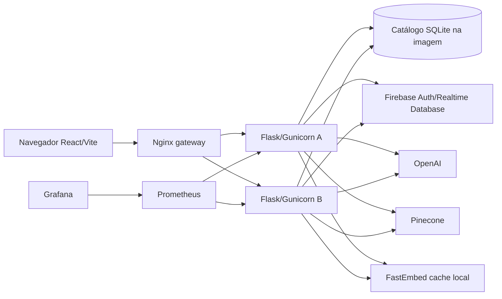

# Arquitetura CourseSphere após a análise

## Componentes

A API segue Blueprints → Services → Models. `backend/app.py` registra rotas e observabilidade; `backend/database/config.py` carrega configuração sem sobrescrever variáveis do processo. Firebase Admin inicializa sob demanda: saúde e catálogo funcionam sem credenciais externas. `backend/database/seed_sqlite_catalog.py` gera o banco local a partir do CSV versionado durante o build da imagem. Muitos cursos têm apenas código, pois a fonte não contém detalhes completos.

## Identidade, dados e rotas

O navegador obtém um Firebase ID token e envia `Authorization: Bearer` nas rotas autenticadas. A API verifica o token pelo Admin SDK e usa o UID verificado para acessar perfil, chats e `users/{uid}/courses`. A API nunca aceita um UID do corpo para escolher o caminho. O CRUD de cursos próprios em `/my/courses` é separado do catálogo público SQLite em `/courses`, que é somente leitura. A recomendação em `POST /users/query` pode ser anônima, aceita token opcional no cabeçalho e consulta OpenAI; na busca semântica gera embeddings locais e consulta Pinecone. Perguntas sobre major/minor/professor continuam sem catálogo verificado.

A interface usa URLs relativas. Em desenvolvimento o Vite encaminha rotas da API ao backend configurado por `BACKEND_PROXY_TARGET` (padrão `http://127.0.0.1:5000`). No Compose, Nginx serve a interface e distribui chamadas de API entre duas instâncias. Prometheus coleta `/metrics` diretamente na rede Docker; Grafana lê o Prometheus. `/health` testa processo e `/ready` consulta SQLite. O gateway não publica `/metrics`.

## Configuração e limites

O Compose padrão não injeta `.env` do backend e usa valores Firebase Web fictícios no build. `compose.test-env.yaml` é um override para projetos externos de teste confirmados. `VITE_*` são públicos no bundle; chaves Admin e APIs externas ficam só no backend. O modelo FastEmbed usa cache local (`EMBEDDING_CACHE_DIR`) e `local_files_only=True`; o cache precisa ser preparado para recomendações reais. O banco local é gerado na imagem; para novos dados de catálogo, refaça a imagem. Os dados de usuário persistem no Firebase remoto.

Veja [relatório final](RELATORIO_FINAL.md), [observabilidade](OBSERVABILIDADE.md) e [modelo de ameaças](THREAT_MODEL_E_RESILIENCIA.md) para evidências, risco e decisões.
