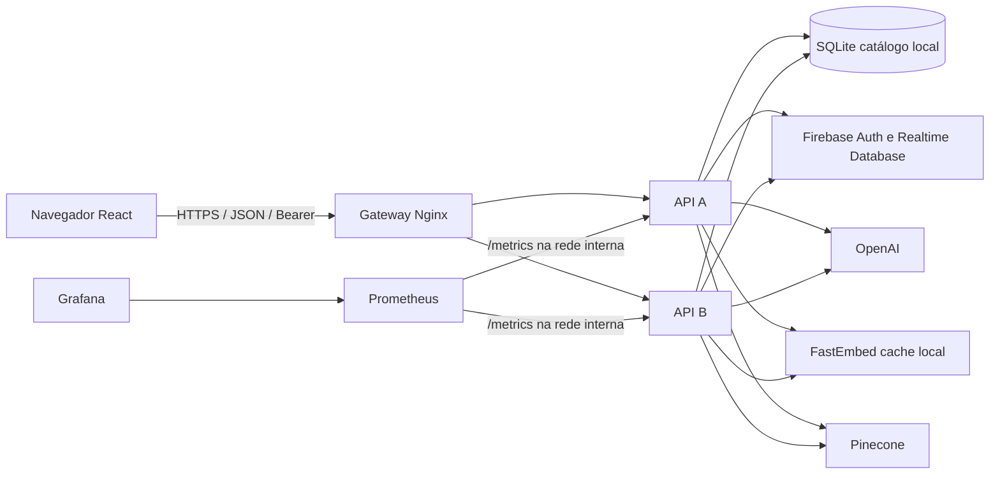

# Modelo de ameaças e resiliência

Data: 27/10/2026. Este documento é um desenho para a versão analisada, não uma alegação de deploy em produção.

## Fluxo de dados e fronteiras

O navegador é não confiável: controla URL, Origin, JSON, histórico e IDs. O gateway cruza a fronteira pública e aplica limites, cabeçalhos e balanceamento. A API recebe ID token, verifica a identidade no Firebase Admin e só então escolhe `users/{uid}`. OpenAI recebe conteúdo de pergunta/perfil/histórico; Pinecone recebe vetores e consulta índice. O catálogo e cache local ficam em cada imagem, sem escrita de usuário. Prometheus e Grafana têm portas restritas ao loopback no Compose.

## STRIDE do fluxo de cursos próprios e recomendação

| Ameaça | Entrada ou ativo | Controle atual | Risco/ação restante |
| --- | --- | --- | --- |
| Spoofing | Bearer falsificado | Verificação de ID token via Firebase Admin; 401 para falha | Confirmar chaves, issuer/audience e expiração com duas contas no projeto de teste. |
| Tampering | `course_id` e JSON do CRUD | ID validado; UID do token define o caminho; campos limitados | Testar regras Realtime Database e concorrência de updates reais. |
| Repudiation | Alteração e exclusão de curso/chat | Request ID e log de operação sem dados pessoais | Definir retenção, controle de acesso e trilha de auditoria em produção. |
| Information disclosure | Token em URL, exceção, Origin | Bearer, respostas estáveis, allowlist CORS e log sem query string | Revisar logs de provedores externos e política do frontend. |
| Denial of service | Cadastro, consulta, lote de chat | Limite de corpo/campo e `limit_req` em Nginx | Quota por identidade/projeto e limite distribuído para múltiplos gateways. |
| Elevation of privilege | Usuário A acessa curso de B | Caminho `users/{uid}/courses`; teste simulado A/B com 404 | Teste ponta a ponta em Firebase e auditoria das regras remotas. |

## Disponibilidade e recuperação

- O gateway tenta outra API em erro ou timeout de conexão para solicitações idempotentes. A demonstração com uma API parada teve seis respostas 200 após o ajuste; o primeiro ensaio falhou em duas. Um POST que chegou ao backend e perdeu a resposta não deve ser repetido sem idempotência, pois pode duplicar escrita.
- O processo da API fica vivo mesmo se Firebase/OpenAI/Pinecone falharem. `/ready` testa apenas SQLite, para preservar catálogo público. Taxas de 5xx e latência por rota revelam falhas parciais; `up` sozinho não as detecta.
- OpenAI, Pinecone e cache FastEmbed são pré-requisitos do caminho de recomendação. A chamada de interpretação OpenAI recebeu timeout de 12 s e zero retry automático; definir orçamento total antes de produção e reexecutar apenas operações comprovadamente seguras, com jitter e limite de tentativas. Um circuit breaker compartilhado pode evitar cascata quando o provedor estiver indisponível, mas exige medição do limiar e estratégia de recuperação. A implementação atual ainda não tem esse circuito.
- A imagem gera SQLite do CSV versionado. Dados de usuário residem em Firebase e exigem backup/restore do projeto. Grafana e Prometheus usam volumes Docker; a retenção e backup dessas séries não foram configurados.
- Em produção, separar gateways/instâncias por host ou zona, usar rede privada e TLS no ponto público, restringir saída a provedores necessários e guardar segredos em gerenciador próprio. A conta Admin deve ter acesso mínimo viável; verificar a política efetiva no projeto real antes de uso.

## Kubernetes e nuvem: condições para demonstração real

Kubernetes pode usar `GET /health` como liveness e `GET /ready` como readiness em cada pod, com réplicas ≥2 e Service à frente. O catálogo empacotado deve ser validado antes da implantação; uma atualização da imagem substitui os dados locais. O ingress/gateway precisaria de rate limit comum, TLS e políticas de rede. Não havia cluster local ou acesso de nuvem validado nesta análise; nenhum manifesto foi aplicado nem deploy anunciado como realizado. O Compose é o ambiente de demonstração verificado.
